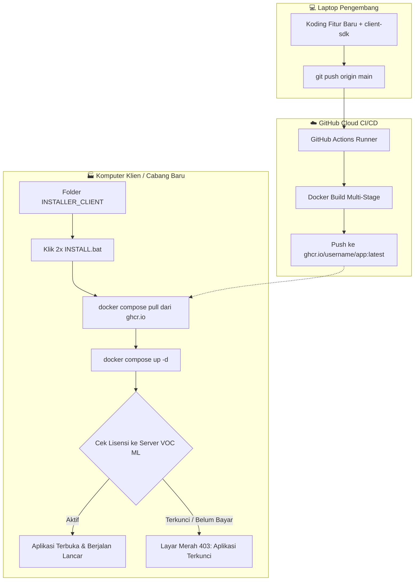

# 🚀 Panduan Master: Otomasi Docker, GitHub Actions, Multi-Cabang & Sistem Lisensi VOC ML

Panduan komprehensif ini dirancang agar Anda dapat menduplikasi arsitektur enterprise (seperti pada aplikasi Billiard VOC) ke aplikasi baru Anda (seperti **Aplikasi Konveksi / Garment, Laundry, Bengkel, Restoran, atau POS Kasir**).

Dengan panduan ini, sistem Anda memiliki 4 pilar utama:
1. **Otomasi CI/CD Cloud**: Setiap kali Anda `git push origin main`, **GitHub Actions** otomatis mem-build Docker Image dan mengunggahnya ke **GitHub Container Registry (`ghcr.io`)**.
2. **One-Click Installer (`INSTALL.bat`)**: Klien/cabang **tidak perlu** menginstall Node.js, Git, atau mendownload source code. Cukup klik 2x `INSTALL.bat`, aplikasi langsung berjalan.
3. **Multi-Cabang Ready**: Dukungan untuk membuka cabang baru tanpa koding ulang, baik di PC terpisah maupun dalam 1 PC server sentral.
4. **Sistem Lisensi Pengunci (VOC ML)**: Aplikasi dilindungi lisensi berbasis Machine ID komputer klien menggunakan SDK VOC ML. Jika lisensi belum diaktivasi dari dashboard pusat Anda, aplikasi terkunci dengan layar merah otomatis (*Red Lock Screen*).

---

## 📑 Daftar Isi
1. [Alur Arsitektur Sistem](#1-alur-arsitektur-sistem)
2. [Struktur Folder Standar Proyek](#2-struktur-folder-standar-proyek)
3. [Integrasi Sistem Lisensi VOC ML (client-sdk)](#3-integrasi-sistem-lisensi-voc-ml-client-sdk)
   - [A. File SDK Lisensi](#a-file-sdk-lisensi)
   - [B. Middleware Pengunci (`license.mjs`)](#b-middleware-pengunci-license-mjs)
   - [C. Pemasangan ke Server Utama](#c-pemasangan-ke-server-utama)
4. [Dockerfile & GitHub Actions CI/CD](#4-dockerfile--github-actions-cicd)
   - [A. Multi-Stage Dockerfile](#a-multi-stage-dockerfile)
   - [B. GitHub Actions Workflow (`build-and-push.yml`)](#b-github-actions-workflow-build-and-pushyml)
5. [Paket Installer Klien (`INSTALLER_CLIENT`)](#5-paket-installer-klien-installer_client)
   - [A. `docker-compose.yml`](#a-docker-composeyml)
   - [B. `INSTALL.bat` (Otomasi Lengkap)](#b-installbat-otomasi-lengkap)
   - [C. Script Pendukung (`UPDATE.bat`, `BUKA_APLIKASI.bat`, `STOP.bat`)](#c-script-pendukung)
6. [Strategi Membuka Cabang Baru](#6-strategi-membuka-cabang-baru)
   - [Skenario A: PC Mandiri di Tiap Cabang](#skenario-a-pc-mandiri-di-tiap-cabang-rekomendasi-utama)
   - [Skenario B: Multi-Cabang di 1 PC / VPS Pusat](#skenario-b-multi-cabang-di-1-pc--server-vps-pusat)
7. [Prompt Sakti Siap Pakai untuk AI Engine](#7-prompt-sakti-siap-pakai-untuk-ai-engine)

---

## 1. Alur Arsitektur Sistem



---

## 2. Struktur Folder Standar Proyek

```text
nama-proyek-anda/
├── client-sdk/                  <-- SDK Lisensi VOC ML
│   ├── vocml-client.js
│   └── get-machine-id.ps1
├── src/                         <-- Kode sumber aplikasi (Express / NestJS / Next.js)
│   ├── license.mjs              <-- Middleware pengunci lisensi
│   └── server.mjs
├── .github/
│   └── workflows/
│       └── build-and-push.yml   <-- Otomasi build & upload Docker image
├── Dockerfile                   <-- Multi-stage build production
├── docker-compose.yml           <-- Compose untuk dev lokal
└── INSTALLER_CLIENT/            <-- FOLDER INI YANG DIBERIKAN KE KLIEN / CABANG
    ├── docker-compose.yml       <-- Mengambil image dari ghcr.io
    ├── .env.example             <-- Pengaturan port & info cabang
    ├── INSTALL.bat              <-- Klik 2x untuk pasang & jalankan
    ├── UPDATE.bat               <-- Klik 2x untuk update versi terbaru
    ├── BUKA_APLIKASI.bat        <-- Klik 2x untuk membuka di browser
    ├── STOP.bat                 <-- Klik 2x untuk mematikan kontainer
    └── PANDUAN_KLIEN.txt
```

---

## 3. Integrasi Sistem Lisensi VOC ML (client-sdk)

### A. File SDK Lisensi
Pastikan 2 file dari folder `client-sdk` berada di proyek Anda:
1. `vocml-client.js`: Modul logika enkripsi RSA & komunikasi ke server VOC ML.
2. `get-machine-id.ps1`: Skrip PowerShell untuk membaca hardware Machine ID unik motherboard/CPU Windows.

---

### B. Middleware Pengunci (`src/license.mjs`)
Simpan file ini di proyek Anda untuk memeriksa lisensi secara berkala dan menampilkan layar merah pengunci jika lisensi ditolak/belum aktif:

```javascript
import { checkLicense } from '../client-sdk/vocml-client.js';

// Status lisensi dalam memory
let licenseStatus = {
  allowed: false,
  reason: 'Sedang memeriksa lisensi...',
  machineId: process.env.VOCML_MACHINE_ID || 'MEMERIKSA...',
  storeName: process.env.STORE_NAME || 'Cabang Baru',
  expiresAt: null
};

// Konfigurasi Lisensi VOC ML
const VOCML_CONFIG = {
  serverUrl: process.env.VOCML_SERVER_URL || 'http://localhost:8080', // Domain server VOC ML Anda
  product: process.env.VOCML_PRODUCT || 'konveksi',                   // Nama produk terdaftar di VOC ML
  storeName: process.env.STORE_NAME || 'Cabang Baru',
  machineId: process.env.VOCML_MACHINE_ID || null,
  publicKeyPem: process.env.VOCML_PUBLIC_KEY || `-----BEGIN PUBLIC KEY-----
PASTE_PUBLIC_KEY_VOCML_MILIK_ANDA_DI_SINI
-----END PUBLIC KEY-----`,
  cacheFile: process.env.VOCML_CACHE_FILE || '/data/license-cache.json',
  appVersion: '1.0.0'
};

let pollTimer = null;

// Fungsi pemeriksaan lisensi
export async function runLicenseVerification() {
  try {
    const res = await checkLicense(VOCML_CONFIG);
    licenseStatus = {
      allowed: res.allowed,
      reason: res.reason || (res.allowed ? 'Aktif' : 'Lisensi Tidak Sah'),
      machineId: res.machineId || VOCML_CONFIG.machineId,
      storeName: VOCML_CONFIG.storeName,
      expiresAt: res.expiresAt || null
    };

    if (res.allowed) {
      console.log(`[VOCML] ✅ Lisensi Valid untuk "${VOCML_CONFIG.storeName}". Cek ulang dalam 3 jam.`);
      scheduleNextCheck(3 * 60 * 60 * 1000); // 3 Jam
    } else {
      console.warn(`[VOCML] 🔒 APLIKASI TERKUNCI: ${res.reason}. Cek ulang dalam 5 detik...`);
      scheduleNextCheck(5 * 1000); // 5 Detik
    }
  } catch (err) {
    licenseStatus.allowed = false;
    licenseStatus.reason = `Gagal terhubung ke server lisensi: ${err.message}`;
    scheduleNextCheck(5 * 1000);
  }
}

function scheduleNextCheck(delayMs) {
  if (pollTimer) clearTimeout(pollTimer);
  pollTimer = setTimeout(runLicenseVerification, delayMs);
}

// Mulai cek lisensi saat server start
runLicenseVerification();

// HTML Layar Merah (Aplikasi Terkunci)
function renderLockedScreenHTML(status) {
  return `<!DOCTYPE html>
<html lang="id">
<head>
  <meta charset="UTF-8">
  <meta name="viewport" content="width=device-width, initial-scale=1.0">
  <title>Aplikasi Terkunci - Lisensi Diperlukan</title>
  <style>
    * { box-sizing: border-box; margin: 0; padding: 0; font-family: -apple-system, BlinkMacSystemFont, 'Segoe UI', Roboto, sans-serif; }
    body { background: #7f1d1d; color: #fff; min-height: 100vh; display: flex; align-items: center; justify-content: center; padding: 20px; }
    .card { background: #991b1b; border: 2px solid #ef4444; border-radius: 16px; max-width: 540px; width: 100%; padding: 32px; box-shadow: 0 25px 50px -12px rgba(0,0,0,0.5); text-align: center; }
    .icon { font-size: 54px; margin-bottom: 16px; }
    h1 { font-size: 24px; font-weight: 900; text-transform: uppercase; letter-spacing: 0.05em; margin-bottom: 8px; color: #fecaca; }
    p.desc { font-size: 14px; color: #fca5a5; margin-bottom: 24px; line-height: 1.5; }
    .info-box { background: rgba(0,0,0,0.3); border-radius: 10px; padding: 16px; margin-bottom: 24px; text-align: left; font-size: 13px; }
    .info-row { display: flex; justify-content: space-between; margin-bottom: 8px; }
    .info-row:last-child { margin-bottom: 0; }
    .label { color: #fca5a5; font-weight: 600; }
    .value { color: #fff; font-family: monospace; font-weight: 700; word-break: break-all; }
    .pulse { display: inline-block; width: 10px; height: 10px; background: #ef4444; border-radius: 50%; margin-right: 6px; animation: blink 1s infinite; }
    @keyframes blink { 0%, 100% { opacity: 1; } 50% { opacity: 0.3; } }
    .footer { font-size: 11px; color: #fca5a5; }
  </style>
  <script>
    // Auto refresh setiap 5 detik agar langsung terbuka jika sudah diaktifkan di VOC ML
    setTimeout(() => { window.location.reload(); }, 5000);
  </script>
</head>
<body>
  <div class="card">
    <div class="icon">🔒</div>
    <h1>Aplikasi Terkunci</h1>
    <p class="desc">Aplikasi ini membutuhkan lisensi aktif dari server pusat. Halaman ini akan otomatis terbuka setelah lisensi disetujui.</p>
    
    <div class="info-box">
      <div class="info-row">
        <span class="label">Outlet / Toko:</span>
        <span class="value">${status.storeName}</span>
      </div>
      <div class="info-row">
        <span class="label">Alasan:</span>
        <span class="value" style="color:#fecaca;">${status.reason}</span>
      </div>
      <div class="info-row">
        <span class="label">Machine ID:</span>
        <span class="value">${status.machineId}</span>
      </div>
    </div>

    <p class="footer"><span class="pulse"></span>Memeriksa status aktivasi otomatis setiap 5 detik...</p>
  </div>
</body>
</html>`;
}

// Middleware Express / Node HTTP
export function licenseGuardMiddleware(req, res, next) {
  // Abaikan route health check internal atau webhook aktivasi
  if (req.path === '/api/health' || req.path === '/api/license-status') {
    return next();
  }

  if (!licenseStatus.allowed) {
    res.status(403).setHeader('Content-Type', 'text/html; charset=utf-8');
    return res.send(renderLockedScreenHTML(licenseStatus));
  }

  next();
}
```

---

### C. Pemasangan ke Server Utama (`server.mjs` atau `app.js`)

Pasang middleware `licenseGuardMiddleware` sebelum rute utama aplikasi:

```javascript
import express from 'express';
import { licenseGuardMiddleware } from './src/license.mjs';

const app = express();

// Pasang pengunci lisensi di baris paling atas middleware
app.use(licenseGuardMiddleware);

// Rute aplikasi Anda (hanya bisa diakses jika lisensi AKTIF)
app.use(express.static('public'));
app.get('/api/orders', (req, res) => res.json({ success: true }));

app.listen(3000, () => {
  console.log('🚀 Server berjalan di http://localhost:3000');
});
```

---

## 4. Dockerfile & GitHub Actions CI/CD

### A. Multi-Stage Dockerfile (`Dockerfile`)

```dockerfile
# ── Stage 1: Build ──
FROM node:20-alpine AS builder
WORKDIR /app

COPY package*.json ./
RUN npm ci

COPY . .
RUN npm run build 2>/dev/null || true

# ── Stage 2: Production Runner ──
FROM node:20-alpine AS runner
WORKDIR /app
ENV NODE_ENV=production

# Install curl/wget untuk container healthcheck
RUN apk add --no-cache curl wget

COPY package*.json ./
RUN npm ci --only=production

COPY --from=builder /app ./

EXPOSE 3000
CMD ["node", "server.mjs"]
```

---

### B. GitHub Actions Workflow (`.github/workflows/build-and-push.yml`)

Setiap kali Anda menjalankan `git push origin main`, GitHub secara gratis akan mem-build dan mem-push image ke `ghcr.io`:

```yaml
name: 🐳 Build & Push Docker Image

on:
  push:
    branches: [main, master]
  workflow_dispatch:

env:
  REGISTRY: ghcr.io
  IMAGE_NAME: ${{ github.repository }} # Otomatis menggunakan username/nama-repo

jobs:
  build-and-push:
    runs-on: ubuntu-latest
    permissions:
      contents: read
      packages: write

    steps:
      - name: 📥 Checkout Repository
        uses: actions/checkout@v4

      - name: 🔧 Set up Docker Buildx
        uses: docker/setup-buildx-action@v3

      - name: 🔑 Login ke GitHub Container Registry
        uses: docker/login-action@v3
        with:
          registry: ${{ env.REGISTRY }}
          username: ${{ github.actor }}
          password: ${{ secrets.GITHUB_TOKEN }}

      - name: 🏷️ Extract Metadata
        id: meta
        uses: docker/metadata-action@v5
        with:
          images: ${{ env.REGISTRY }}/${{ env.IMAGE_NAME }}
          tags: |
            type=raw,value=latest
            type=sha,prefix=sha-

      - name: 🚀 Build & Push Docker Image
        uses: docker/build-push-action@v5
        with:
          context: .
          file: ./Dockerfile
          push: true
          tags: ${{ steps.meta.outputs.tags }}
          labels: ${{ steps.meta.outputs.labels }}
          cache-from: type=gha
          cache-to: type=gha,mode=max
```

---

## 5. Paket Installer Klien (`INSTALLER_CLIENT`)

Folder ini adalah **satu-satunya folder** yang Anda berikan ke klien / cabang toko.

### A. `docker-compose.yml` di Klien
```yaml
version: '3.8'

services:
  app:
    image: ghcr.io/username_anda/nama-repo:latest
    container_name: konveksi_app
    restart: unless-stopped
    ports:
      - "${PORT:-3001}:3000"
    environment:
      - PORT=3000
      - STORE_NAME=${STORE_NAME:-Cabang Utama}
      - VOCML_SERVER_URL=${VOCML_SERVER_URL:-https://lisensi.domainanda.com}
      - VOCML_PRODUCT=konveksi
      - VOCML_MACHINE_ID=${VOCML_MACHINE_ID:-}
    volumes:
      - ./data:/data
    healthcheck:
      test: ["CMD-SHELL", "wget -qO- http://localhost:3000/api/health || exit 0"]
      interval: 30s
      timeout: 5s
      retries: 3
```

---

### B. `INSTALL.bat` (Otomasi Lengkap)
Script pintar yang otomatis membaca Machine ID Windows menggunakan PowerShell, membuat file `.env`, pull docker image dari GitHub, dan membuka aplikasi:

```bat
@echo off
setlocal enabledelayedexpansion
title Setup Aplikasi & Lisensi VOC ML
color 0A
cls

echo ============================================================
echo   SISTEM INSTALASI OTOMATIS SATU KLIK (DOCKER + VOC ML)
echo ============================================================
echo.

:: 1. Self-Elevation Admin
net session >nul 2>&1
if %errorlevel% neq 0 (
    echo [INFO] Meminta hak akses Administrator...
    powershell -NoProfile -ExecutionPolicy Bypass -Command "Start-Process cmd.exe -ArgumentList '/c \"%~f0\"' -Verb RunAs"
    exit /b 0
)

:: 2. Cek Docker Desktop
echo [1/5] Memeriksa Docker Desktop...
docker --version >nul 2>&1
if %errorlevel% neq 0 (
    echo.
    echo [ERROR] Docker Desktop belum berjalan!
    echo Silakan buka Docker Desktop terlebih dahulu hingga berstatus 'Running'.
    echo Download: https://www.docker.com/products/docker-desktop/
    echo.
    pause
    exit /b 1
)
echo [OK] Docker Desktop aktif.

:: 3. Deteksi Machine ID Komputer Windows
echo [2/5] Membaca Machine ID hardware...
set "MACHINE_ID="
for /f "usebackq delims=" %%i in (`powershell -NoProfile -ExecutionPolicy Bypass -Command "try { (Get-CimInstance Win32_ComputerSystemProduct).UUID } catch { (Get-WmiObject Win32_ComputerSystemProduct).UUID }"`) do set "MACHINE_ID=%%i"
if "%MACHINE_ID%"=="" set "MACHINE_ID=WIN-%RANDOM%-%RANDOM%"
echo [OK] Machine ID terdeteksi: %MACHINE_ID%

:: 4. Buat File .env Otomatis
echo [3/5] Menyiapkan konfigurasi outlet...
if not exist ".env" (
    echo Masukkan Nama Cabang / Toko ini:
    set /p "INPUT_STORE=Nama Outlet (contoh: Konveksi Cabang Solo): "
    if "!INPUT_STORE!"=="" set "INPUT_STORE=Cabang Baru"
    
    (
      echo PORT=3001
      echo STORE_NAME=!INPUT_STORE!
      echo VOCML_MACHINE_ID=%MACHINE_ID%
      echo VOCML_SERVER_URL=https://lisensi.domainanda.com
    ) > .env
    echo [OK] File .env berhasil dibuat dengan Machine ID otomatis.
) else (
    echo [OK] File .env sudah ada.
)

:: 5. Download Image Terbaru & Start
echo.
echo [4/5] Mengunduh versi aplikasi terbaru dari cloud...
docker compose pull
if %errorlevel% neq 0 (
    echo [WARNING] Gagal pull image cloud, menjalankan dari cache lokal jika ada...
)

echo.
echo [5/5] Memulai kontainer aplikasi...
docker compose down >nul 2>&1
docker compose up -d

echo.
echo Menunggu inisialisasi aplikasi (10 detik)...
timeout /t 10 /nobreak >nul

echo.
echo ============================================================
echo   INSTALASI SELESAI!
echo   Machine ID Komputer ini : %MACHINE_ID%
echo   Daftarkan Machine ID di atas pada Dashboard VOC ML Anda.
echo ============================================================
echo.

start http://localhost:3001
pause
```

---

### C. Script Pendukung

#### `UPDATE.bat` (Update Aplikasi Klien Tanpa Instal Ulang)
```bat
@echo off
title Update Versi Aplikasi
echo Mengunduh pembaruan fitur terbaru...
docker compose pull
docker compose up -d
echo Pembaruan berhasil diterapkan!
timeout /t 3 >nul
start http://localhost:3001
```

#### `BUKA_APLIKASI.bat`
```bat
@echo off
start http://localhost:3001
```

#### `STOP.bat`
```bat
@echo off
docker compose down
echo Aplikasi berhasil dimatikan.
pause
```

---

## 6. Strategi Membuka Cabang Baru

### Skenario A: PC Mandiri di Tiap Cabang (Rekomendasi Utama)
Setiap toko / pabrik konveksi memiliki komputer kasir sendiri:
1. Tidak perlu koding lagi di laptop pengembang.
2. Salin folder `INSTALLER_CLIENT` ke PC cabang baru (lewat Flashdisk atau Google Drive).
3. Klik 2x `INSTALL.bat`.
4. Salin **Machine ID** yang muncul di layar CMD, lalu masukkan ke **Dashboard VOC ML** Anda untuk mengaktifkan lisensinya.
5. Begitu Anda klik "Aktifkan" di dashboard pusat, layar merah di komputer cabang langsung terbuka sendiri dalam 5 detik!

---

### Skenario B: Multi-Cabang di 1 PC / Server VPS Pusat
Menjalankan beberapa cabang di 1 mesin yang sama tanpa bentrok port:

| Cabang | Folder | Port Web | Mapping Port di docker-compose.yml | Volume Data |
| :--- | :--- | :--- | :--- | :--- |
| **Cabang 1 (Pusat)** | `C:\App\Cabang_Jakarta\` | `http://localhost:3001` | `3001:3000` | `./data:/data` |
| **Cabang 2 (Solo)** | `C:\App\Cabang_Solo\` | `http://localhost:3002` | `3002:3000` | `./data_solo:/data` |
| **Cabang 3 (Bandung)**| `C:\App\Cabang_Bandung\`| `http://localhost:3003` | `3003:3000` | `./data_bdg:/data` |

Cukup ubah port sebelah kiri di `docker-compose.yml` cabang tersebut sebelum menjalankan `INSTALL.bat`.

---

## 7. Prompt Sakti Siap Pakai untuk AI Engine

Salin prompt di bawah ini ke AI (ChatGPT, Claude, atau Gemini) saat Anda memulai proyek aplikasi baru apa pun:

```markdown
Halo AI, saya ingin membangun aplikasi web [SEBUTKAN NAMA APLIKASI, misal: Sistem Manajemen Konveksi & Produksi Baju] berbasis Node.js/Express atau Next.js.

Saya ingin aplikasi ini langsung dilengkapi dengan arsitektur standar enterprise:
1. SISTEM PENGUNCI LISENSI (VOC ML):
   - Saya memiliki SDK lisensi di folder `client-sdk/` berisi `vocml-client.js` dan `get-machine-id.ps1`.
   - Buatkan middleware `license.mjs` yang memanggil `checkLicense()` dari SDK.
   - Konfigurasi lisensi: serverUrl: 'https://lisensi.domainanda.com', product: 'konveksi', publicKeyPem: '[MASUKKAN_PUBLIC_KEY]'.
   - Smart Polling: Jika lisensi aktif, periksa ulang setiap 3 jam. Jika terkunci, periksa ulang setiap 5 detik.
   - Jika lisensi terkunci, blokir semua rute dengan status HTTP 403 dan render halaman HTML layar merah peringatan "Aplikasi Terkunci" yang memuat info Nama Toko, Alasan, Machine ID, dan JavaScript yang me-reload halaman browser otomatis setiap 5 detik begitu lisensi diaktifkan dari dashboard pusat.

2. OTOMASI DOCKER & GITHUB ACTIONS (CI/CD):
   - Buatkan multi-stage `Dockerfile` production.
   - Buatkan workflow `.github/workflows/build-and-push.yml` yang otomatis mem-build dan mengunggah Docker image ke GitHub Container Registry (ghcr.io) dengan tag :latest setiap kali ada git push ke branch main.

3. ONE-CLICK INSTALLER KLIEN (WINDOWS .BAT):
   - Siapkan folder mandiri `INSTALLER_CLIENT/` untuk pengguna akhir (tanpa source code / tanpa perlu install Node.js/Git).
   - Di dalamnya sertakan `docker-compose.yml` yang me-pull image dari ghcr.io.
   - Buatkan `INSTALL.bat` yang otomatis:
     * Meminta hak Administrator (UAC).
     * Memastikan Docker Desktop aktif.
     * Membaca hardware UUID / Machine ID komputer secara otomatis menggunakan PowerShell.
     * Mengisi file `.env` dengan Machine ID dan nama toko.
     * Melakukan `docker compose pull` dan `docker compose up -d`.
     * Menampilkan Machine ID di layar dan otomatis membuka browser ke http://localhost:3001.
   - Buatkan juga script `UPDATE.bat`, `BUKA_APLIKASI.bat`, dan `STOP.bat`.

Tolong susun seluruh kode dan struktur filenya secara lengkap, rapi, dan modular!
```
