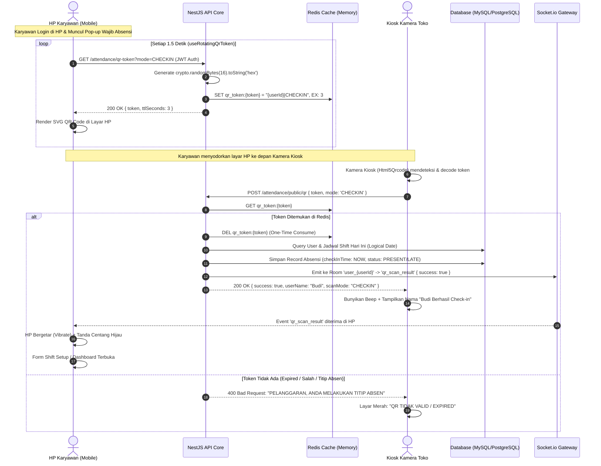
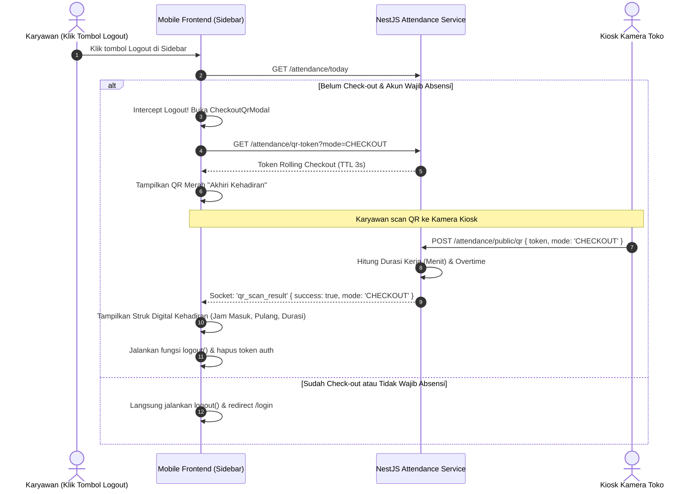
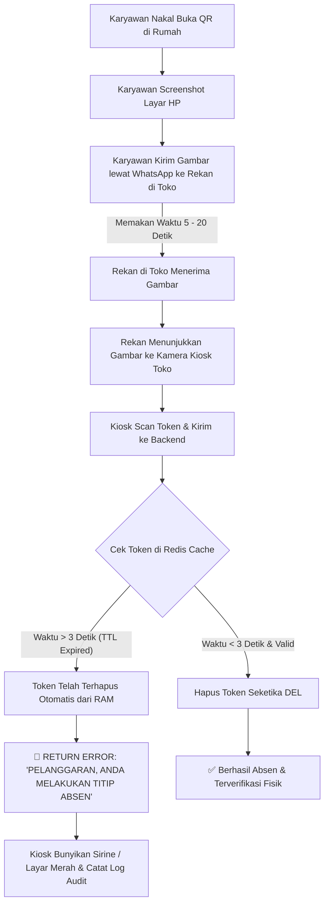

# 📘 PRD & SPESIFIKASI ARSITEKTUR TEKNOLOGI ABSENSI QR ANTI-TITIP ABSEN (ROLLING QR KIOSK)

> **Versi Dokumen:** 1.0.0  
> **Status:** Production Reference Architecture  
> **Proyek Referensi:** Cosmo Pool / BilliardVOC Management System  
> **Lisensi & Hak Akses:** Dokumen Referensi Internal & Rancang Bangun Aplikasi Serupa  

---

## 📑 DAFTAR ISI
1. [Latar Belakang & Problem Statement](#1-latar-belakang--problem-statement)
2. [Prinsip Desain & Inovasi Utama (Paradigma Baru)](#2-prinsip-desain--inovasi-utama-paradigma-baru)
3. [Arsitektur Sistem Tingkat Tinggi (High-Level Architecture)](#3-arsitektur-sistem-tingkat-tinggi-high-level-architecture)
4. [Alur & Diagram Kerja Sistem (Mermaid Flowcharts)](#4-alur--diagram-kerja-sistem-mermaid-flowcharts)
   - 4.1. Alur Lengkap Check-In (Sequence Diagram)
   - 4.2. Alur Check-Out Saat Logout Karyawan
   - 4.3. Diagram Logika Anti-Fraud (Penolakan Screenshot/Titip Absen)
5. [Spesifikasi Teknis & Mekanisme Rolling Token](#5-spesifikasi-teknis--mekanisme-rolling-token)
   - 5.1. Siklus Hidup Token di Redis (TTL 3 Detik)
   - 5.2. Rotasi Token di Sisi Client (Interval 1.5 Detik)
   - 5.3. Struktur Payload & Keamanan (Zero PII Payload)
6. [Kontrak API & Protokol Komunikasi](#6-kontrak-api--protokol-komunikasi)
   - 6.1. Endpoint Backend (REST API)
   - 6.2. Protokol Real-Time (Socket.io WebSocket)
7. [Skema Basis Data (Database Schema & Entities)](#7-skema-basis-data-database-schema--entities)
8. [Logika Operasional Khusus (Nightlife & Billiard Operational Date)](#8-logika-operasional-khusus-nightlife--billiard-operational-date)
9. [Implementasi Komponen Frontend (Kode Referensi)](#9-implementasi-komponen-frontend-kode-referensi)
   - 9.1. Custom Hook `useRotatingQrToken`
   - 9.2. Komponen Display QR (`ShiftSetupOverlay` / `CheckoutQrModal`)
   - 9.3. Mesin Pemindai Kiosk (`Html5Qrcode`)
10. [Kebijakan Akses Kamera & Keamanan Jaringan (Mobile & Kiosk)](#10-kebijakan-akses-kamera--keamanan-jaringan-mobile--kiosk)
11. [Checklist Replikasi untuk Membangun Sistem Serupa](#11-checklist-replikasi-untuk-membangun-sistem-serupa)

---

## 1. LATAR BELAKANG & PROBLEM STATEMENT

### Kelemahan Fatal Sistem Absensi QR Tradisional
Hampir 90% sistem absensi berbasis QR Code konvensional menerapkan model **"Karyawan Scan QR di Dinding"**:
1. Kantor/Toko menempelkan stiker QR Code statis di dinding atau meja kasir.
2. Karyawan datang membawa HP, membuka aplikasi, menyalakan kamera, lalu memindai stiker tersebut.

**Mengapa Model Konvensional Gagal Total Menghentikan Kecurangan?**
- **Titip Absen Sangat Mudah:** Karyawan yang ada di lokasi cukup memotret stiker QR tersebut dengan HP, lalu mengirimkannya lewat WhatsApp/Telegram ke rekannya yang sedang tidur di rumah. Rekan di rumah membuka foto tersebut di layar laptop dan memindainya dengan HP.
- **Manipulasi Geolocation (Fake GPS):** Jika sistem dilengkapi validasi GPS, karyawan dapat dengan mudah menggunakan aplikasi "Mock Location" / Fake GPS di Android untuk memalsukan koordinat.
- **Biaya Hardware Mahal:** Menggunakan mesin sidik jari (fingerprint) fisik membutuhkan pengadaan alat mahal, kabel LAN, integrasi SDK yang rumit, dan rawan rusak akibat debu atau sidik jari berminyak.

---

## 2. PRINSIP DESAIN & INOVASI UTAMA (PARADIGMA BARU)

Sistem ini membalikkan seluruh konsep absensi konvensional menggunakan pendekatan **Reverse-Scanning Architecture + Rolling Ephemeral Token**:

```
[MODEL LAMA - Rawan Curang]
Karyawan (Kamera Aktif)  ───>  QR Code Statis di Dinding (Mudah difoto & disebar)

[MODEL KAMI - Zero Fraud]
Karyawan (Menampilkan Dynamic QR 3s)  ───>  Kamera Kiosk Fisik Toko (Memindai HP Karyawan)
```

### 4 Pilar Utama Keamanan:
1. **Reverse Scanning (Kiosk Memindai Karyawan):**  
   Kamera pemindai berada permanen di toko (Kiosk Display Kasir, Tab Kasir, atau Monitor Display Toko). Karyawan **wajib hadir secara fisik** membawa HP-nya ke hadapan kamera kasir/kiosk.
2. **Ephemeral Rolling QR (Token Berganti Tiap 1.5 Detik, Expire 3 Detik):**  
   QR code yang muncul di layar HP karyawan bukan teks statis, melainkan token acak unik (*nonce*) dengan masa hidup hanya **3 detik** di Redis. Setiap 1.5 detik, layar HP meminta token baru. Screenshot yang dikirim lewat WhatsApp akan kedaluwarsa sebelum sempat dibuka di penerima.
3. **Zero-PII Payload (QR Bebas Identitas):**  
   Gambar QR Code **tidak memuat nama, ID karyawan, ataupun data sensitif**. Isi QR murni berupa string acak 16-byte hex (contoh: `d3b07384d113edec49eaa6238ad5ff00`). Pemetaan siapa pemilik token hanya disimpan di memori RAM Redis server.
4. **Single-Use Atomic Consumption (One-Time-Pad):**  
   Saat Kiosk membaca token, backend membaca dan langsung menghapusnya dari Redis (`DEL`) dalam satu transaksi atomik. Token yang sama tidak dapat dipakai dua kali.

---

## 3. ARSITEKTUR SISTEM TINGKAT TINGGI (HIGH-LEVEL ARCHITECTURE)

```
┌──────────────────────────────────────────────────────────────────────────────────┐
│                             PERANGKAT KARYAWAN (HP)                              │
│                                                                                  │
│  ┌───────────────────────┐             ┌──────────────────────────────────────┐  │
│  │  ShiftSetupOverlay /  │             │       WebSocket (Socket.io) Client   │  │
│  │   CheckoutQrModal     │             │       Room: "user_{userId}"          │  │
│  │                       │             │                                      │  │
│  │  [ Rotating QR ]      │             │  Menerima Event:                     │  │
│  │  TTL: 3s (Rotate 1.5s)│             │  - qr_scan_result (Haptic + Unlock)  │  │
│  └──────────┬────────────┘             └──────────────────▲───────────────────┘  │
└─────────────┼─────────────────────────────────────────────┼──────────────────────┘
              │ 1. GET /attendance/qr-token                 │
              │    (Request Rolling Nonce)                  │
              ▼                                             │
┌──────────────────────────────────────────────┐            │ 6. Push Notifikasi Real-time
│             BACKEND NESTJS CORE              │            │    via Room Socket Pribadi
│                                              │            │
│  ┌────────────────────────────────────────┐  │            │
│  │        AttendanceService               │  │            │
│  │  - generateQrToken() -> Redis SET (3s) │  │            │
│  │  - processQrToken()  -> Redis GET+DEL  │──┼────────────┘
│  │  - checkIn() / checkOut()              │  │
│  │  - getLogicalDateString() (Cutoff Biz) │  │
│  └──────────────────┬─────────────────────┘  │
│                     │                        │
│         ┌───────────┴───────────┐            │
│         ▼                       ▼            │
│   ┌───────────┐           ┌───────────┐      │
│   │   REDIS   │           │  MYSQL /  │      │
│   │ (In-Mem)  │           │ POSTGRES  │      │
│   │  TTL 3s   │           │ (DB Log)  │      │
│   └───────────┘           └───────────┘      │
└─────────────────────▲────────────────────────┘
                      │
                      │ 5. POST /attendance/public/qr
                      │    { token, mode: 'CHECKIN' }
                      │
┌─────────────────────┴────────────────────────────────────────────────────────────┐
│                       KIOSK TOKO / DISPLAY KASIR (STATION CAMERA)                │
│                                                                                  │
│  ┌────────────────────────────────────────────────────────────────────────────┐  │
│  │  Halaman Kiosk Web: /display atau /admin/attendance                         │  │
│  │  Camera Engine: Html5Qrcode Library (FPS: 15, facingMode: "user")           │  │
│  │  Tindakan: Terus memantau QR yang disodorkan karyawan ke depan lensa       │  │
│  └────────────────────────────────────────────────────────────────────────────┘  │
└──────────────────────────────────────────────────────────────────────────────────┘
```

---

## 4. ALUR & DIAGRAM KERJA SISTEM (MERMAID FLOWCHARTS)

### 4.1. Alur Lengkap Check-In (Sequence Diagram)



---

### 4.2. Alur Check-Out Saat Logout Karyawan



---

### 4.3. Diagram Logika Anti-Fraud (Penolakan Screenshot/Titip Absen)



---

## 5. SPESIFIKASI TEKNIS & MEKANISME ROLLING TOKEN

### 5.1. Siklus Hidup Token di Redis
- **Key Format:** `qr_token:<random_hex_string>`
- **Value Format:** `<userId>|<mode>` (contoh: `14|CHECKIN`)
- **TTL (Time-To-Live):** `3 detik` (`AttendanceService.QR_TTL_SECONDS = 3`)
- **Atomic Deletion:** Fungsi `processQrToken()` menggunakan pemanggilan `await this.redisService.del(key)` tepat setelah token berhasil dibaca, memastikan **Zero Replay Attack**.

```typescript
// backend/src/attendance/attendance.service.ts
static readonly QR_TTL_SECONDS = 3;

async generateQrToken(userId: number, mode?: 'CHECKIN' | 'CHECKOUT') {
  const ttl = AttendanceService.QR_TTL_SECONDS;
  const token = crypto.randomBytes(16).toString('hex'); // 32 karakter hex acak
  
  // Nilai hanya disimpan di Redis RAM, QR fisik tidak membawa identitas
  await this.redisService.set(
    `qr_token:${token}`, 
    mode ? `${userId}|${mode}` : String(userId), 
    ttl
  );
  
  return {
    token,
    expiresAt: new Date(Date.now() + ttl * 1000),
    ttlSeconds: ttl,
    mode: mode || null,
  };
}
```

### 5.2. Rotasi Token di Sisi Client (Interval 1.5 Detik)
Client tidak boleh menunggu sampai token habis (3 detik) untuk meminta token baru. Jika menunggu 3 detik, saat token disodorkan ke kamera bisa jadi sisa usianya tinggal 0.1 detik dan gagal didecode.
- **Interval Permintaan:** **1.5 detik** (`QR_ROTATE_MS = 1500`).
- Dengan demikian, token yang sedang aktif di layar selalu memiliki sisa masa berlaku minimal **1.5 hingga 3 detik** saat dibaca oleh lensa kamera Kiosk.
- **Page Visibility Optimizer:** Jika layar HP dimatikan atau tab aplikasi berpindah ke background, interval berhenti otomatis untuk menghemat bandwidth server dan baterai HP.

---

## 6. KONTRAK API & PROTOKOL KOMUNIKASI

### 6.1. Endpoint Backend (REST API)

#### 1. Generate Rolling Token
- **Endpoint:** `GET /attendance/qr-token`
- **Auth:** Bearer JWT (Pengguna Login di HP)
- **Query Params:**
  - `mode`: `'CHECKIN'` | `'CHECKOUT'`
- **Response `200 OK`:**
  ```json
  {
    "token": "e84f67c2114bb8148e658ba3a09fae41",
    "expiresAt": "2026-10-13T15:00:03.000Z",
    "ttlSeconds": 3,
    "mode": "CHECKIN"
  }
  ```

#### 2. Public Scan Verification (Oleh Mesin Kiosk)
- **Endpoint:** `POST /attendance/public/qr`
- **Auth:** Public / Kiosk Network Whitelist
- **Request Body:**
  ```json
  {
    "token": "e84f67c2114bb8148e658ba3a09fae41",
    "mode": "CHECKIN"
  }
  ```
- **Response Success `201 Created`:**
  ```json
  {
    "id": 1042,
    "userId": 14,
    "userName": "Rian Ardiansyah",
    "scanMode": "CHECKIN",
    "date": "2026-10-13",
    "checkInTime": "2026-10-13T15:00:01.850Z",
    "status": "PRESENT",
    "isApproved": true,
    "shiftName": "SHIFT 1"
  }
  ```
- **Response Fail `400 Bad Request`:**
  ```json
  {
    "statusCode": 400,
    "message": "PELANGGARAN, ANDA MELAKUKAN TITIP ABSEN",
    "error": "Bad Request"
  }
  ```

#### 3. Status Kehadiran Hari Ini
- **Endpoint:** `GET /attendance/today`
- **Auth:** Bearer JWT (Pengguna Login)
- **Response `200 OK`:**
  ```json
  {
    "id": 1042,
    "date": "2026-10-13",
    "checkInTime": "2026-10-13T08:00:00.000Z",
    "checkOutTime": null,
    "workDurationMinutes": null,
    "status": "PRESENT",
    "isApproved": true
  }
  ```

---

### 6.2. Protokol Real-Time (Socket.io WebSocket)

Saat Kiosk berhasil memproses token, Kiosk tidak perlu tahu siapa pemilik token secara detail. Backend otomatis memancarkan event ke kamar socket privat milik user:

- **Socket Room:** `user_${userId}`
- **Event Name:** `qr_scan_result`
- **Payload:**
  ```typescript
  interface QrScanResultPayload {
    success: boolean;
    mode: 'CHECKIN' | 'CHECKOUT';
    status?: 'PRESENT' | 'LATE' | 'OVERTIME' | 'PENDING';
    isApproved?: boolean;
    time?: string;
    workDurationMinutes?: number;
    overtimeMinutes?: number;
    message?: string;
  }
  ```

---

## 7. SKEMA BASIS DATA (DATABASE SCHEMA & ENTITIES)

Tabel `attendances` menggunakan relasi unik komposit per hari operasional:

```sql
CREATE TABLE `attendances` (
  `id` INT AUTO_INCREMENT PRIMARY KEY,
  `userId` INT NOT NULL,
  `date` DATE NOT NULL COMMENT 'Format YYYY-MM-DD (Logical Operational Date)',
  `checkInTime` TIMESTAMP NULL,
  `checkOutTime` TIMESTAMP NULL,
  `workDurationMinutes` INT NULL COMMENT 'Total menit kerja riil',
  `status` ENUM('PRESENT', 'LATE', 'OVERTIME', 'ABSENT', 'PENDING', 'SAKIT', 'IZIN', 'ALPHA') DEFAULT 'PRESENT',
  `isApproved` BOOLEAN DEFAULT FALSE,
  `approvedBy` VARCHAR(255) NULL,
  `approvedAt` TIMESTAMP NULL,
  `overtimeMinutes` INT DEFAULT 0,
  `isManual` BOOLEAN DEFAULT FALSE,
  `shiftName` VARCHAR(255) NULL,
  `note` TEXT NULL,
  `createdAt` TIMESTAMP DEFAULT CURRENT_TIMESTAMP,
  `updatedAt` TIMESTAMP DEFAULT CURRENT_TIMESTAMP ON UPDATE CURRENT_TIMESTAMP,
  `payrollReleaseId` INT NULL,
  
  UNIQUE KEY `IDX_user_date` (`userId`, `date`),
  CONSTRAINT `FK_attendance_user` FOREIGN KEY (`userId`) REFERENCES `users` (`id`) ON DELETE CASCADE
) ENGINE=InnoDB DEFAULT CHARSET=utf8mb4;
```

---

## 8. LOGIKA OPERASIONAL KHUSUS (NIGHTLIFE & BILLIARD OPERATIONAL DATE)

Bisnis Billiard, Cafe, Restoran, dan Bar memiliki karakteristik unik: **jam tutup seringkali melewati tengah malam (misal buka jam 10:00 pagi dan tutup jam 03:00 subuh)**.

Jika sistem menggunakan tanggal kalender murni (`new Date()`):
- Karyawan check-in jam 17:00 (Hari Senin, tanggal 12).
- Karyawan check-out jam 02:00 subuh (Hari Selasa, tanggal 13).
- Akibatnya sistem akan error karena menganggap check-out berada di tanggal yang berbeda dengan check-in!

### Solusi: Logical Operational Cutoff Date
Sistem menggunakan fungsi `getLogicalDateString()` yang didukung konfigurasi `businessDayOffset` (misal jam `06:00` subuh).

```typescript
// backend/src/attendance/attendance.service.ts
async getLogicalDateString(now?: Date): Promise<string> {
  const settings = await this.settingsService.getSettings();
  const offset = settings?.businessDayOffset || '06:00'; // Cutoff pergantian hari operasional
  const [cutoffHour, cutoffMinute] = offset.split(':').map(Number);

  const target = now || new Date();
  const logical = new Date(target);

  const cutoff = new Date(target);
  cutoff.setHours(cutoffHour, cutoffMinute, 0, 0);

  // Jika waktu sekarang masih sebelum jam cutoff (misal jam 02:00 subuh),
  // maka operasional masih dihitung sebagai hari kemarin!
  if (target < cutoff) {
    logical.setDate(logical.getDate() - 1);
  }

  const year = logical.getFullYear();
  const month = String(logical.getMonth() + 1).padStart(2, '0');
  const day = String(logical.getDate()).padStart(2, '0');
  return `${year}-${month}-${day}`;
}
```

---

## 9. IMPLEMENTASI KOMPONEN FRONTEND (KODE REFERENSI)

### 9.1. Custom Hook `useRotatingQrToken`
Hook ini bertanggung jawab melakukan polling token dari server dan membatasi rotasi saat aplikasi berada di latar belakang.

```typescript
// frontend/src/lib/hooks/useRotatingQrToken.ts
import { useCallback, useEffect, useRef, useState } from 'react';
import axios from 'axios';

export const QR_ROTATE_MS = 1500; // Rotasi tiap 1.5 detik

export function useRotatingQrToken(mode: 'CHECKIN' | 'CHECKOUT', enabled: boolean) {
    const [token, setToken] = useState<string | null>(null);
    const [ttlMs, setTtlMs] = useState(3000);
    const [issuedAt, setIssuedAt] = useState<number>(0);
    const [error, setError] = useState(false);
    const inFlight = useRef(false);

    const refresh = useCallback(async () => {
        if (inFlight.current) return;
        if (typeof document !== 'undefined' && document.visibilityState === 'hidden') return;
        inFlight.current = true;
        try {
            const res = await axios.get('/attendance/qr-token', { params: { mode } });
            setToken(res.data.token);
            setTtlMs((res.data.ttlSeconds ?? 3) * 1000);
            setIssuedAt(Date.now());
            setError(false);
        } catch (e) {
            setError(true);
        } finally {
            inFlight.current = false;
        }
    }, [mode]);

    useEffect(() => {
        if (!enabled) { setToken(null); return; }
        refresh();
        const id = setInterval(refresh, QR_ROTATE_MS);
        const onVis = () => { if (document.visibilityState === 'visible') refresh(); };
        document.addEventListener('visibilitychange', onVis);
        return () => {
            clearInterval(id);
            document.removeEventListener('visibilitychange', onVis);
        };
    }, [enabled, refresh]);

    const clear = useCallback(() => setToken(null), []);

    return { token, ttlMs, issuedAt, error, refresh, clear };
}
```

---

### 9.2. Komponen Display QR di Layar Karyawan
Rendering token menjadi QR Code SVG menggunakan pustaka `qrcode.react`:

```tsx
import { QRCodeSVG } from 'qrcode.react';
import { useRotatingQrToken } from '@/lib/hooks/useRotatingQrToken';

export function AttendanceQrCard() {
    const { token, refresh } = useRotatingQrToken('CHECKIN', true);

    return (
        <div className="flex flex-col items-center justify-center p-6 bg-white rounded-3xl shadow-xl">
            <h3 className="text-lg font-black text-slate-800 uppercase tracking-wider mb-4">
                Scan QR di Kamera Kasir
            </h3>
            <div className="p-4 bg-slate-50 border-4 border-dashed border-indigo-200 rounded-2xl">
                {token ? (
                    <QRCodeSVG value={token} size={240} level="H" />
                ) : (
                    <div className="w-[240px] h-[240px] flex items-center justify-center text-slate-400">
                        Memuat Token...
                    </div>
                )}
            </div>
            <p className="text-xs text-slate-400 font-bold mt-4 animate-pulse">
                QR diperbarui secara otomatis setiap detik
            </p>
        </div>
    );
}
```

---

### 9.3. Mesin Pemindai Kiosk (`Html5Qrcode`)
Dipasang pada perangkat Kiosk (Tablet/PC Kasir yang membuka `/display` atau `/admin/attendance`):

```tsx
import { useEffect, useRef } from 'react';
import { Html5Qrcode } from 'html5-qrcode';
import axios from 'axios';

export function KioskScanner() {
    const scanBusy = useRef(false);

    useEffect(() => {
        const html5QrCode = new Html5Qrcode("kiosk-qr-scanner");
        
        html5QrCode.start(
            { facingMode: "user" }, // Kamera depan kiosk
            { fps: 15, qrbox: { width: 280, height: 280 } },
            async (decodedToken) => {
                if (scanBusy.current) return;
                scanBusy.current = true;
                
                try {
                    const res = await axios.post('/attendance/public/qr', {
                        token: decodedToken.trim(),
                        mode: 'CHECKIN'
                    });
                    alert(`Halo ${res.data.userName}, Absensi Berhasil!`);
                } catch (err: any) {
                    alert(err.response?.data?.message || 'QR Tidak Valid!');
                } finally {
                    setTimeout(() => { scanBusy.current = false; }, 2000);
                }
            },
            () => { /* Abaikan frame kosong */ }
        ).catch(console.error);

        return () => {
            if (html5QrCode.isScanning) html5QrCode.stop().catch(console.error);
        };
    }, []);

    return <div id="kiosk-qr-scanner" className="w-[320px] h-[320px] rounded-3xl overflow-hidden" />;
}
```

---

## 10. KEBIJAKAN AKSES KAMERA & KEAMANAN JARINGAN (MOBILE & KIOSK)

Jika Anda menerapkan sistem di mana kamera berjalan di browser HP atau perangkat web lokal:

### 1. Wajib HTTPS untuk WebRTC Camera API
Browser modern (Google Chrome, Apple Safari) **memblokir akses `navigator.mediaDevices.getUserMedia`** jika website berjalan di atas protokol `http://` tanpa SSL, kecuali di `http://localhost`.

- **Solusi untuk Lingkungan Produksi Lokal:**
  1. **Tunneling HTTPS Cepat (Ngrok / Cloudflare Tunnel):**
     Jalankan `ngrok http 3000` (Frontend) dan `ngrok http 4000` (Backend). Hubungkan HP ke URL HTTPS yang dihasilkan.
  2. **SSL Lokal (Mkcert):**
     Buat sertifikat SSL lokal terpercaya untuk IP Server (misal `192.168.1.100`), lalu pasang profil sertifikat di perangkat Kiosk/HP.
  3. **Bypass Chrome Khusus Android:**
     Di Chrome Android buka `chrome://flags/#unsafely-treat-insecure-origin-as-secure`, masukkan `http://192.168.1.10:3000`, lalu aktifkan.

---

## 11. CHECKLIST REPLIKASI UNTUK MEMBANGUN SISTEM SERUPA

Saat Anda membangun aplikasi baru dengan mekanisme ini di masa depan, gunakan checklist berikut:

- [ ] **Infrastructure Layer:**
  - Siapkan Redis Server untuk penyimpanan in-memory key-value.
  - Setup Socket.io Gateway untuk koneksi WebSocket dua arah.
- [ ] **Backend Service:**
  - Buat generator nonce acak (`crypto.randomBytes(16)`).
  - Terapkan Redis SET dengan TTL maksimal 3 detik.
  - Terapkan endpoint verifikasi dengan pembacaan dan penghapusan atomik (`GET` lalu `DEL`).
  - Implementasikan algoritma `getLogicalDateString()` jika sistem beroperasi melintasi tengah malam.
- [ ] **Frontend Client (Employee Device):**
  - Pasang hook interval pembaruan 1.5 detik (`useRotatingQrToken`).
  - Pastikan interval di-pause saat `document.visibilityState === 'hidden'`.
  - Pasang listener WebSocket `qr_scan_result` untuk umpan balik instan ke karyawan.
- [ ] **Frontend Kiosk (Station Scanner):**
  - Pasang pustaka `html5-qrcode` dengan `facingMode: "user"` atau pemindai hardware QR USB (HID Barcode Scanner).
  - Tambahkan throttling debounce (`scanBusyRef`) agar token yang sama tidak ter-submit ganda dalam satu milidetik.
- [ ] **Hak Akses & Override:**
  - Tambahkan saklar `requiresAttendance` per akun jika ada direksi atau investor yang tidak wajib absen.
  - Buat sistem auto-approval untuk role manajerial dan manual approval untuk staf harian.

---

*Dokumen ini disusun sebagai cetak biru (blueprint) rekayasa perangkat lunak arsitektur absensi zero-fraud terintegrasi.*
